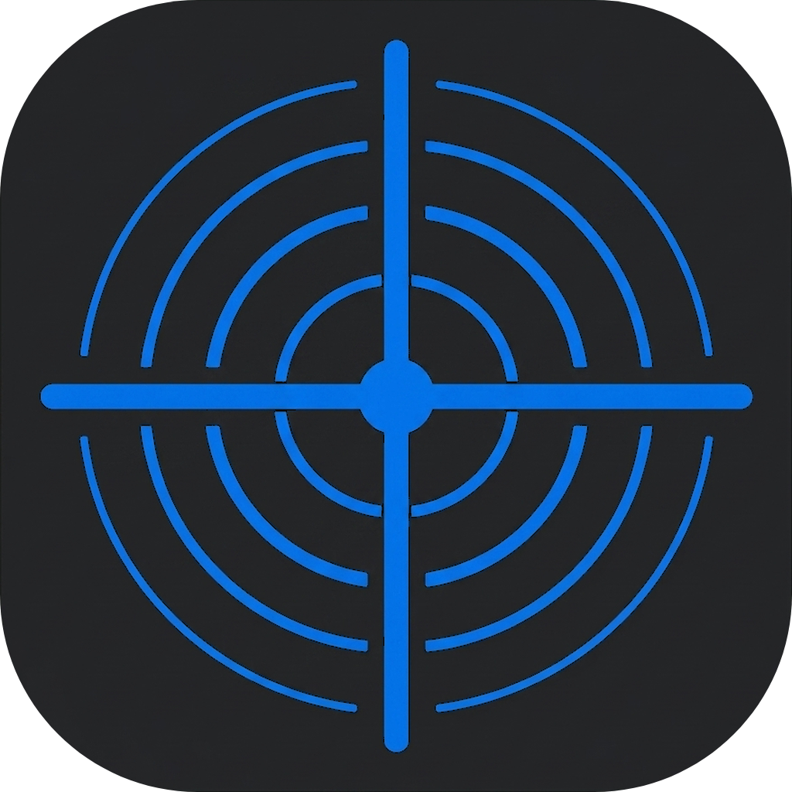
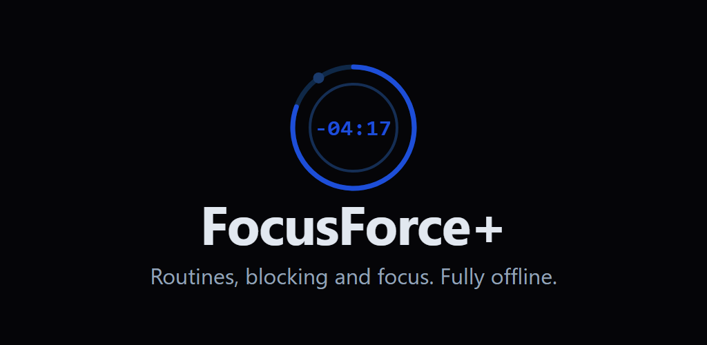
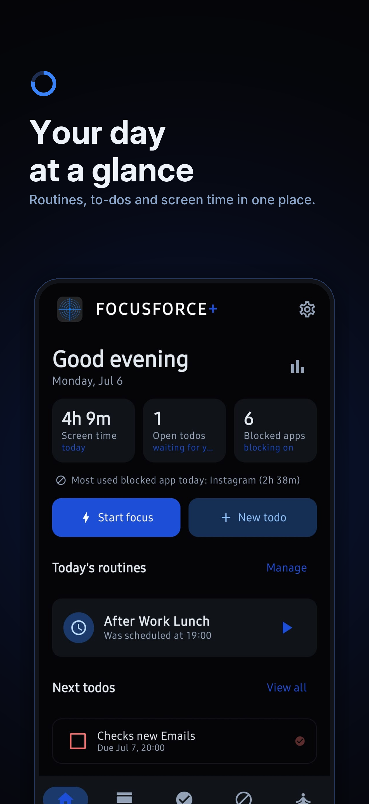
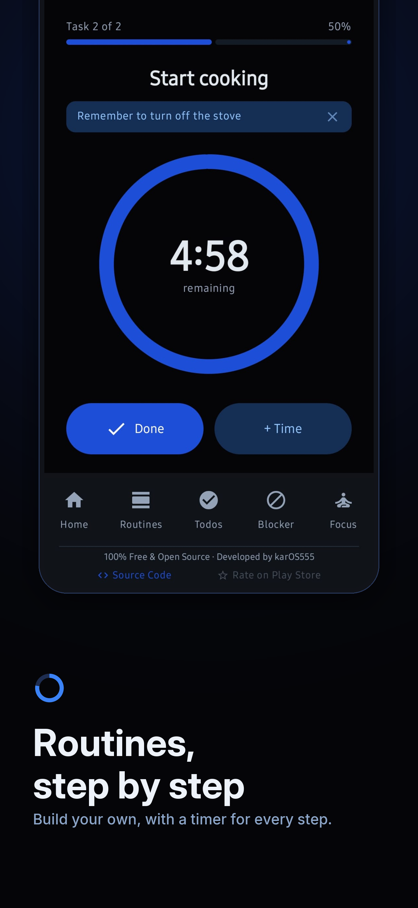
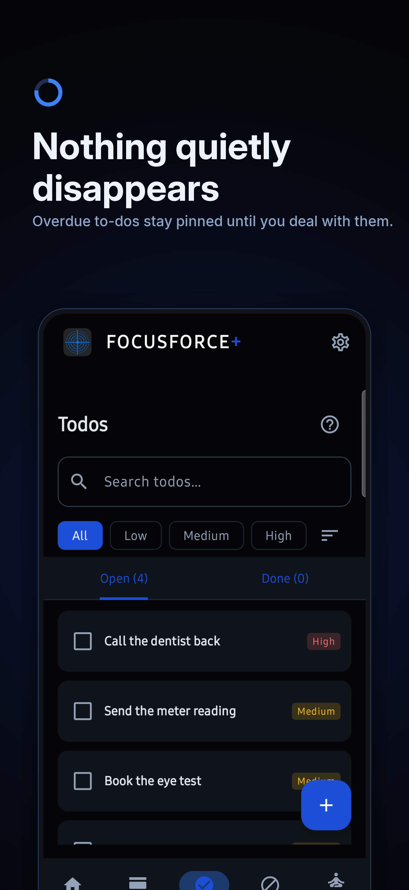
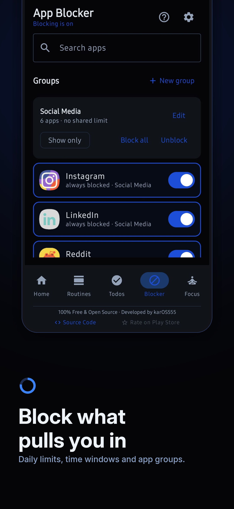
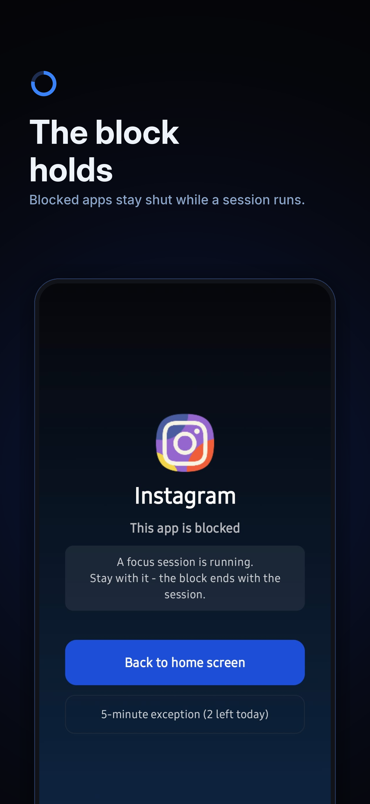
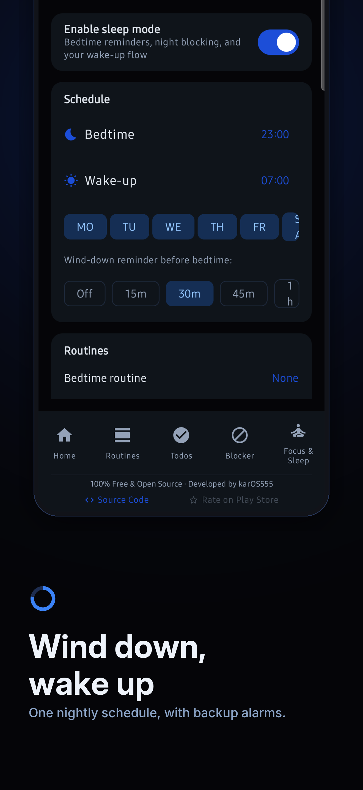

 
 

# FocusForce+

### Routines, to-dos, app blocking, focus and sleep mode in one app, with reminders that are hard to ignore.

 

 

<!-- Enable once FocusForce+ is listed on IzzyOnDroid. Check both URLs against the
     current IzzyOnDroid docs before turning this on.

-->

No Play Store needed. Grab the latest APK and install it directly. [How to install](#install)

 

> [!NOTE]
> FocusForce+ is in public beta. Everything is built and it runs on real devices, but it hasn't had a wide test yet, so expect the odd rough edge. If you hit one, please [open an issue](../../issues), it really helps.

 

<h2 id="what-it-is"> What it is</h2>

FocusForce+ puts five things that usually live in five separate apps into one: strict **routines**, a nagging **to-do planner**, an **app blocker**, a **focus mode**, and a **sleep mode**. The whole point is that it doesn't let you wriggle out of your own plans the second motivation dips.

It's aimed at people whose brains need more structure than most apps assume: ADHD, trouble reining in your own habits, or just losing too many hours to your phone. Everything stays on your phone: no account, no cloud, no ads, no tracking.

I built it for myself first, and I use it every day. Nothing I tried before held up once the motivation was gone. Putting it on GitHub came later, but if your brain works anything like mine, it might fit you too.

<h2 id="screenshots"> Screenshots</h2>

&nbsp;

&nbsp;

&nbsp;

&nbsp;

<h2 id="whats-inside"> What's inside</h2>

- **Routines** — a real alarm at the start time and a countdown for every step
- **To-dos** — a planner that won't let things quietly slip
- **App blocker** — daily limits, time windows and app groups
- **Focus mode** — one timed session with Do Not Disturb and blocked apps
- **Sleep mode** — one nightly schedule, from wind-down to wake-up
- **Dashboard and statistics** — your day at a glance, plus a weekly view

<b>The details</b>

 

**Routines.** Multi-step routines with a real alarm at the start time, a countdown for every step, and a heads-up before each one ends. Run over time and the timer keeps going into the negative and keeps reminding you.

**To-dos.** A planner that won't let things quietly slip. Timed to-dos alarm you like a routine does. Loose ones resurface a few times a day. Overdue ones stay pinned until you deal with them.

**App blocker.** Block distracting apps by a daily time limit, a fixed time window (overnight works too), or automatically during routines and focus sessions. Bundle apps into groups that share one limit, one blocking schedule, and one set of rules.

**Focus mode.** One session that turns on Do Not Disturb, silences notifications, and blocks the apps or groups you pick, for a set stretch of time. Start one on the spot or schedule it.

**Sleep mode.** One nightly schedule: a wind-down reminder, Do Not Disturb, and your distracting apps out of reach until morning. Bedtime and wake-up can each kick off a routine, and it can put backup alarms in your phone's own clock app so waking up never depends on this one.

**Home dashboard.** Your day at a glance: today's routines and their status, the to-dos that need you next, screen time, and quick actions.

**Statistics.** A simple weekly view of routines completed and focus minutes logged.

<h2 id="what-makes-it-different"> What makes it different</h2>

**Invincible Mode is per feature, not one big switch.**
Most blocking apps give you a single lockdown toggle; here you turn it on for the individual routine, session or rule you want to commit to. While it's active you can't cancel or weaken that one thing until it reaches its natural end.

**It's friction, not a trap.**
You can always uninstall the app from Android settings, and a factory reset always works. The point is to make bypassing annoying enough that a bad-day version of you doesn't do it for a dumb reason.

**Tamper Protection for the settings themselves.**
Optional second layer: loosening your own lock settings only works inside a short daily window you choose.

**Actually local.**
No internet permission at all, so your data has no way to leave the device. Everything exports and imports as a plain JSON file.

<h2 id="install"> Install</h2>

1. Open [the latest release](https://github.com/karOS555/FocusForcePlus/releases/latest) and download the `.apk` file.
2. Open it on your phone. Android will ask permission to install from this source the first time. Allow it.
3. Follow the in-app setup guide. It walks you through the permissions each feature needs and explains what every one is for.

Minimum Android version is 8.0 (API 26).

> [!IMPORTANT]
> Some permissions (accessibility for app blocking, usage access for time limits, Do Not Disturb for focus mode) are granted in Android's own settings. The setup guide takes you there and tells you exactly what each one does and doesn't do. Nothing is turned on behind your back.

### Getting updates

The app can't check for updates itself, that's the point. Either use **Settings > About > Check for updates**, which opens the releases page, or let [Obtainium](https://github.com/ImranR98/Obtainium) watch this repo and update the APK for you.

> [!TIP]
> Install Obtainium, then add `https://github.com/karOS555/FocusForcePlus` as a source.

---

 <b>Tech stack</b>

 

| | |
|---|---|
| Language | Kotlin |
| UI | Jetpack Compose, Material 3 |
| Architecture | MVVM, Clean Architecture |
| Database | Room (local SQLite) |
| DI | Hilt |
| Background work | WorkManager, foreground services |
| Reminders | AlarmManager, NotificationCompat |
| App blocking | AccessibilityService, UsageStatsManager |
| Min SDK | 26 (Android 8.0) |

 <b>Project status and roadmap</b>

 

The whole app is built and the first public beta is out. From here it's real-device testing, polish based on feedback, and eventually a Play Store submission.

- [x] Project foundation (Room, Hilt, navigation, dark theme)
- [x] Routines with timers, snooze logic, and Invincible Mode
- [x] To-do planner with the persistent reminder system
- [x] App blocker via AccessibilityService, with groups and time limits
- [x] Focus mode with Do Not Disturb
- [x] Onboarding and settings
- [x] Home dashboard and statistics
- [x] Tamper Protection, JSON backup, quick-settings tile
- [x] First public beta
- [x] Sleep mode with linked routines and backup alarms
- [ ] Stable 1.0 after a testing round
- [ ] Play Store submission

Later ideas: home-screen widgets, calendar sync, a Pomodoro mode, streaks and gamification.

 <b>Privacy</b>

 

Everything runs on your device. The app collects nothing, sends nothing, and has no analytics, crash reporting, or ad SDKs. It has no internet permission.

Permissions are used only for the feature they belong to: accessibility to see which app you opened (so it can be blocked, it never reads screen content), usage access to measure app time for limits, Do Not Disturb access for focus sessions, alarms and notifications for reminders.

Full details are in [PRIVACY.md](PRIVACY.md).

 <b>Contributing</b>

 

Bug reports, ideas, and pull requests are all welcome, especially notes on how the app behaves on your device during the beta. See [CONTRIBUTING.md](CONTRIBUTING.md) for how to get set up and the few ground rules the project sticks to.

 <b>Credits</b>

 

The code is written from scratch in Kotlin, but the ideas and some of the architecture lean on a few great open projects:

- [Mindful](https://github.com/akaMrNagar/Mindful) by akaMrNagar, for the app-blocking and invincible-mode concepts
- [MindMaster](https://github.com/ArmanKhanTech/MindMaster) by ArmanKhanTech, for blocking modes and Kotlin patterns
- [Curbox / DigiPaws](https://github.com/nethical6/digipaws) by nethical6, for gamified blocking ideas
- [Routinery](https://play.google.com/store/apps/details?id=com.routinery.routinery), for routine-execution UX

Icons in this README are from [Lucide](https://github.com/lucide-icons/lucide), used under the ISC License.

---

<h2 id="license"> License</h2>

GNU General Public License v3.0, see [LICENSE](LICENSE). Anything built on top has to stay open under the same license, with the original credit kept.

<h2 id="a-note-on-health"> A note on health</h2>

FocusForce+ is a self-help tool for building focus and habits. It is not a medical device and does not diagnose, treat, cure, or prevent ADHD or any other condition, and it is not a substitute for professional care. If you're struggling, please talk to a qualified healthcare professional.

<h2 id="if-it-helps-you"> If it helps you</h2>

The app collects nothing and never phones home, which means I have no idea whether anyone is actually using it. So if it's doing something for you, a ⭐ on the repo or an [issue](../../issues) is the only signal I get — bugs, rough edges, ideas, or just a line saying it works.

<table><td><a href="#start-of-content">↥ Scroll to top</a></td></table>

---

Built with care for minds that need a little extra structure.

