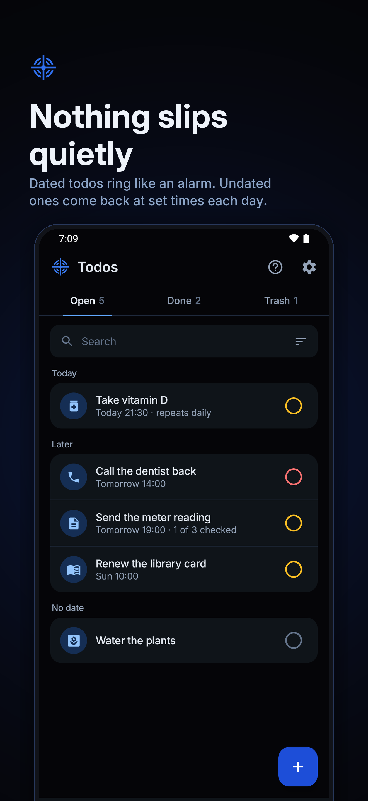
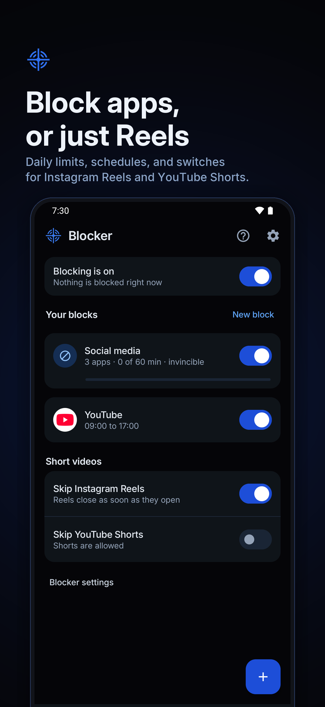
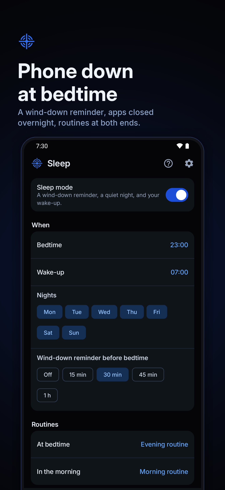

 
 

# FocusForce+

### Routines, todos, lists, an app blocker, focus and sleep mode in one Android app, with reminders you can't just swipe away.

 

 

<!-- Enable once FocusForce+ is listed on IzzyOnDroid. Check both URLs against the
     current IzzyOnDroid docs before turning this on.

-->

Not on the Play Store yet: you install the APK from the releases. [How to install](#install)

 

> [!NOTE]
> FocusForce+ is in public beta. If something breaks or feels wrong on your phone, please [open an issue](../../issues).

## What it does

- **Routines** start with a real alarm and give every step its own timer. Run over and the timer keeps counting and reminds you. Snoozes and reschedules are limited per routine.
- **Todos** get pushier with their priority. Low is one notification. Medium comes up on screen and comes back a couple of times. High rings, and rings again every few minutes. Ticking it off takes a confirmation and a swipe along a path. Todos without a date come back at set times each day.
- **Lists** for shopping and packing. Type several items at once, separated by commas, and earlier items come back as suggestions.
- **The blocker** closes apps always, after a daily limit, or on a schedule, and also during routines and focus sessions. Several apps can share one limit. You can also keep Instagram and YouTube but skip Reels and Shorts.
- **Focus** silences the phone and blocks apps for a set time. Ending early asks first and then makes you wait.
- **Sleep** reminds you to wind down, keeps the night quiet, closes apps until morning and can start a routine at bedtime and at wake-up.
- **Home and statistics** show today's routines, the next todos, screen time, and seven days of focus, routines and todos.

Everything stays on your phone. There is no account, no cloud, and the app has no internet permission.

## Screenshots

&nbsp;

&nbsp;

&nbsp;

&nbsp;

&nbsp;

&nbsp;

## How it holds you to it

**Speed bumps.** Before you tick off a todo, snooze it, push a routine back, end a focus session early or pause a block, the app can ask again, make you wait, or give you a small task: hold a button, drag a slider or a path, or solve a sum. You pick the mix for each of these, and a single todo or routine can have its own. One switch turns them all off.

**Invincible mode, one item at a time.** Lock a single routine, focus session or block instead of the whole phone. Until it ends on its own, it can't be cancelled or weakened.

**Friction, not a trap.** The wait in a speed bump is a minute at most, a reminder never rings forever, and you can always uninstall the app from Android settings. The point is to stop the reflex, not to lock you out of your phone.

**Tamper Protection.** If you turn it on, loosening your own lock settings only works in a short daily window you choose.

## Make it yours

- Choose which modules appear in the bottom bar and in which order, or switch a module off completely.
- Six themes, two of them light, or your own five colours. A theme can be shared as a few lines of text.
- Share text from any app to FocusForce+ to turn it into a todo or list items.
- `focusforceplus://` links start a focus session or a routine, or add a todo, from Tasker, a home-screen shortcut or an NFC tag. They are off until you switch them on, and they can only start and add things, never stop or cancel them.
- Back up everything into a folder every night, for example one that Syncthing or Nextcloud keeps in sync, or export a single file by hand.

## Why it exists

I built it for myself. Every routine app, todo app and blocker I tried stopped working for me the moment motivation dipped, because everything could be swiped away. FocusForce+ is the app I wanted instead, and I use it every day. If your brain works anything like mine, it might fit you too.

## Install

1. Open [the latest release](https://github.com/karOS555/FocusForcePlus/releases/latest) and download the `.apk` file.
2. Open it on your phone. The first time, Android asks whether to allow installs from this source. Allow it.
3. The setup guide walks you through the permissions each part needs and explains what each one is for.

FocusForce+ needs Android 8.0 or newer.

> [!IMPORTANT]
> Blocking needs an accessibility service, daily limits need usage access, and focus needs Do Not Disturb access. You grant these in Android's own settings. The setup guide takes you there and says what each one does and does not do.

### Updates

The app has no internet access, so it can't check for updates itself. Either open **Settings > About > Check for updates**, which opens the releases page, or let [Obtainium](https://github.com/ImranR98/Obtainium) watch this repository: add `https://github.com/karOS555/FocusForcePlus` as a source and it installs new versions for you.

---

<b>Tech stack</b>

 

| | |
|---|---|
| Language | Kotlin |
| UI | Jetpack Compose, Material 3, Inter |
| Architecture | MVVM with data, domain and presentation layers |
| Database | Room (SQLite on the device) |
| DI | Hilt |
| Background work | WorkManager, foreground services, AlarmManager |
| App blocking | AccessibilityService, UsageStatsManager |
| Min SDK | 26 (Android 8.0) |

<b>Roadmap</b>

 

- [x] Routines, todos, blocker, focus and sleep mode
- [x] Home screen, statistics, backups, quick settings tile
- [x] First public beta
- [x] Speed bumps, lists, Reels and Shorts, themes, sharing and start links, nightly backups
- [ ] 1.0 after this testing round
- [ ] Play Store and IzzyOnDroid

Later: calendar events on the home screen, tasks from CalDAV through OpenTasks, home-screen widgets.

<b>Privacy</b>

 

The app collects nothing and sends nothing. There is no analytics, no crash reporting and no ad SDK, and it has no internet permission.

Each permission belongs to one feature. The blocking service only learns which app you opened and reads nothing on the screen. The optional Reels and Shorts service only works inside Instagram and YouTube and only looks for their short-video player. Usage access measures app time for limits and statistics. Do Not Disturb access is for focus and sleep.

All details are in [PRIVACY.md](PRIVACY.md).

<b>Contributing</b>

 

Bug reports, ideas and pull requests are welcome, and so are notes on how the app behaves on your phone. [CONTRIBUTING.md](CONTRIBUTING.md) explains the setup and the few rules the project sticks to.

<b>Credits</b>

 

The code is written from scratch, but some ideas come from these projects:

- [Mindful](https://github.com/akaMrNagar/Mindful) by akaMrNagar, for app blocking and invincible mode
- [MindMaster](https://github.com/ArmanKhanTech/MindMaster) by ArmanKhanTech, for blocking modes and Kotlin patterns
- [Curbox / DigiPaws](https://github.com/nethical6/digipaws) by nethical6, for blocking ideas
- [Routinery](https://play.google.com/store/apps/details?id=com.routinery.routinery), for how a running routine should feel

---

## License

GNU General Public License v3.0, see [LICENSE](LICENSE). Anything built on it has to stay open under the same license and keep the original credit.

## A note on health

FocusForce+ is a self-help tool for focus and habits. It is not a medical device, does not diagnose, treat, cure or prevent ADHD or any other condition, and does not replace professional care. If you're struggling, please talk to a qualified healthcare professional.

## If it helps you

The app never phones home, so I can't tell whether anyone uses it. If it does something for you, a star on the repository or an [issue](../../issues) is the only way I find out, whether it's a bug, an idea or one line saying it works.

<!-- FocusForce+ is developed with the help of AI coding assistants. -->
