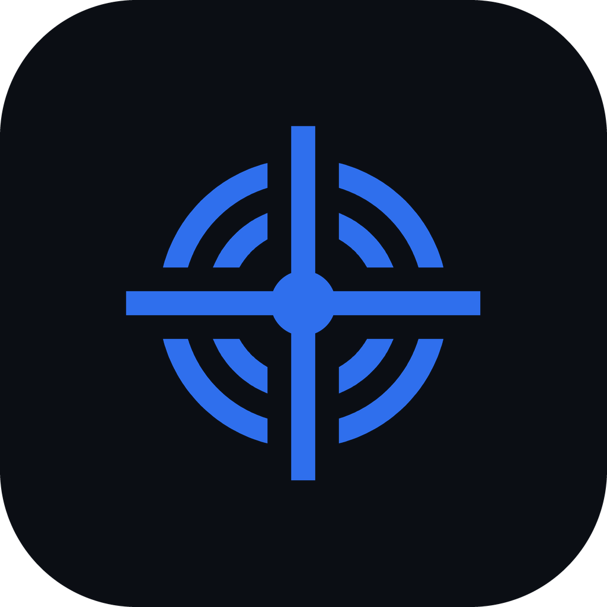
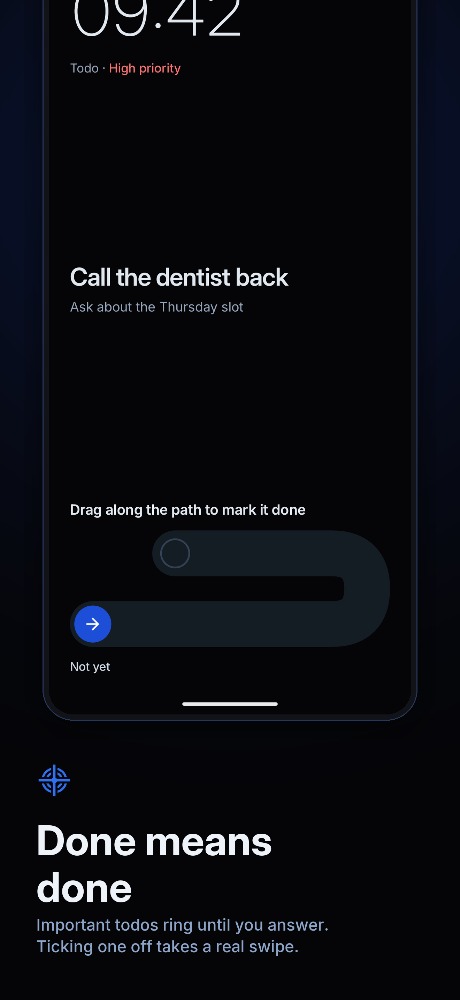
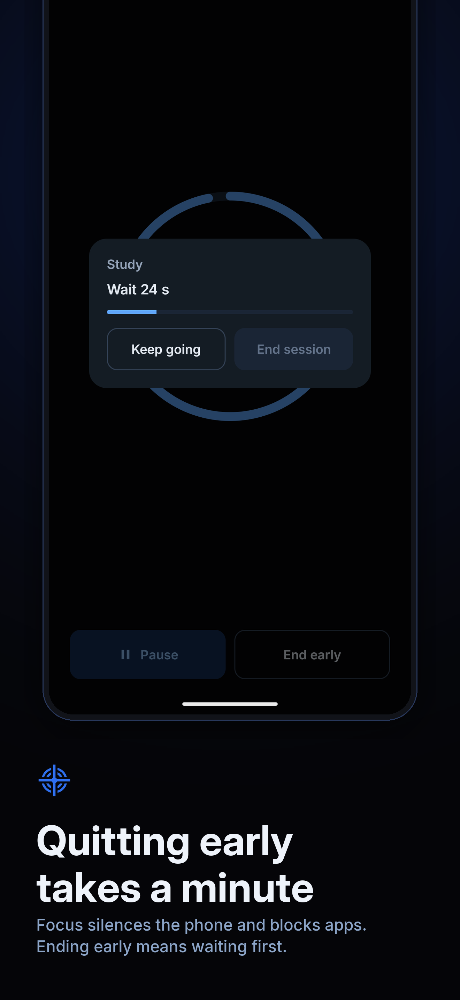
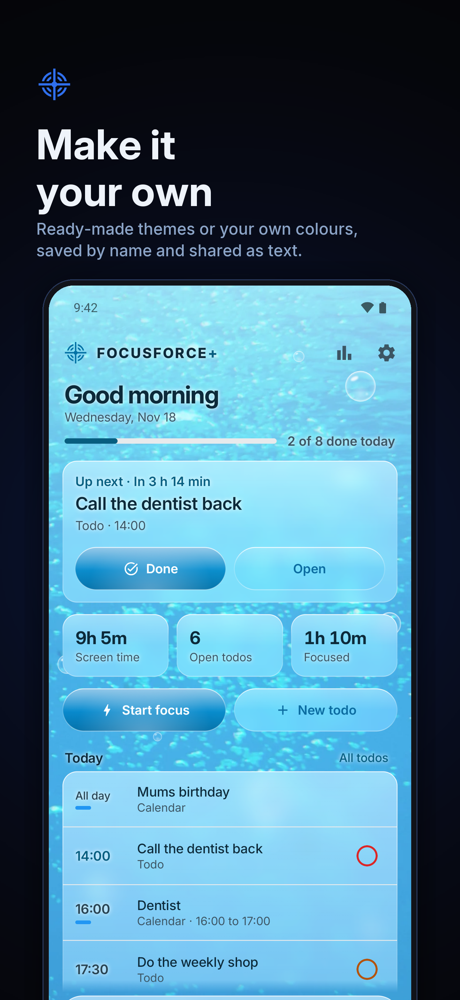

 
 

# FocusForce+

### Routines, todos, lists, an app blocker, focus and sleep mode in one Android app, with reminders you can't just swipe away.

 

 

<!-- Enable once FocusForce+ is listed on IzzyOnDroid. Check both URLs against the
     current IzzyOnDroid docs before turning this on.

-->

Not on the Play Store yet: you install the APK from the releases. [How to install](#install)

 

> [!NOTE]
> FocusForce+ is in public beta. If something breaks or feels wrong on your phone, please [open an issue](../../issues).

<h2 id="why-i-built-it"> Why I built it</h2>

**I built FocusForce+ for myself.** Every routine app, todo app and blocker I tried stopped working for me the moment motivation dipped, because everything in them could be swiped away, snoozed forever or switched off in two taps. So I wrote the app I needed: reminders that come back, routines that start with a real alarm, blocks that hold, and a little friction in front of every way out. I use it every day.

It is made for brains that need more structure than most apps assume: ADHD, habits that run away with you, or too many hours lost to the phone. If yours works anything like mine, it might fit you too.

<h2 id="what-it-does"> What it does</h2>

### Your day, in one place

**Home** answers "what now?": how much of today is done, what is up next with a Start or Done button right there, and then routines, todos and calendar events in one list by time. **Todos** get pushier with their priority. Low is one notification, medium comes up on screen and comes back a couple of times, high rings and rings again. Ticking one off takes a confirmation and a swipe along a path. Todos without a date come back at set times each day.

&nbsp;

&nbsp;

### Routines and lists

**Routines** start with a real alarm and give every step its own timer. Run over and the timer keeps counting and reminds you. Each routine has its own number of snoozes, its own heads-up before the start, and can block apps and switch on Do Not Disturb while it runs. **Lists** are for shopping and packing: type several items at once, with amounts ("2 milk"), sorted into sections in the order you walk through the shop. A todo can carry a list, and so can a routine step, like a packing list for "Pack the bag".

&nbsp;

### Blocking, focus and sleep

**The blocker** closes apps always, after a daily limit, on a schedule, or while a routine, a focus session or a calendar event is on. Several apps can share one limit, and you can keep Instagram and YouTube but skip Reels and Shorts. **Focus** silences the phone and blocks apps for a set time; ending early asks first and then makes you wait. **Sleep** reminds you to wind down, keeps the night quiet, closes apps until morning, and can start a routine at bedtime and at wake-up.

&nbsp;

&nbsp;

### Make it yours

- Six themes or your own colours, saved under a name. **Aero** is a real Frutiger Aero style: frosted glass, glossy see-through buttons and a summer photo of a green hill with soap bubbles behind everything.
- Choose which modules sit in the bottom bar, in which order, or switch a module off.
- Widgets for today, quick focus and a list to tick off.
- Your calendar on Home, todos with a date in it, and blocking during events.
- Two-way sync with OpenTasks or Tasks.org, and with DAVx5 from there to Nextcloud or any CalDAV server.
- Share text from any app to make a todo or list items; `focusforceplus://` links start things from Tasker, shortcuts or NFC tags (off until you switch them on).
- A backup into a folder every night, a file by hand, and an import you can undo.

Everything stays on your phone. There is no account, no cloud, and the app has no internet permission.

<h2 id="how-it-holds-you-to-it"> How it holds you to it</h2>

**Speed bumps.** Before you tick off a todo, snooze it, push a routine back, stop it or a focus session early, or pause a block, the app can ask again, make you wait, or give you a small task: hold a button, drag a slider or a path with two bends, or solve a sum. You pick the mix for each of these, and a single todo or routine can have its own. One switch turns them all off.

**Invincible mode, one item at a time.** Lock a single routine, focus session or block instead of the whole phone. Until it ends on its own, it can't be cancelled or weakened.

**Friction, not a trap.** The wait in a speed bump is a minute at most, a reminder never rings forever, and you can always uninstall the app from Android settings. The point is to stop the reflex, not to lock you out of your phone.

**Tamper Protection.** If you turn it on, loosening your own lock settings only works in a short daily window you choose.

<h2 id="install"> Install</h2>

1. Open [the releases page](https://github.com/karOS555/FocusForcePlus/releases) and download the `.apk` file of the newest release, at the top.
2. Open it on your phone. The first time, Android asks whether to allow installs from this source. Allow it.
3. The setup guide walks you through the permissions each part needs and explains what each one is for.

FocusForce+ needs Android 8.0 or newer.

> [!IMPORTANT]
> Blocking needs an accessibility service, daily limits need usage access, and focus needs Do Not Disturb access. You grant these in Android's own settings. The setup guide takes you there and says what each one does and does not do. Calendar and tasks apps are optional and ask only when you switch them on.

### Updates

The app has no internet access, so it can't check for updates itself. Either open **Settings > About > Check for updates**, which opens the releases page, or let [Obtainium](https://github.com/ImranR98/Obtainium) watch this repository and install new versions for you.

> [!TIP]
> Install Obtainium, then add `https://github.com/karOS555/FocusForcePlus` as a source. While the app is in beta, switch on **Include prereleases** there, or Obtainium finds no version.

---

 <b>Tech stack</b>

 

| | |
|---|---|
| Language | Kotlin |
| UI | Jetpack Compose, Material 3, Inter, Glance for widgets |
| Architecture | MVVM with data, domain and presentation layers |
| Database | Room (SQLite on the device) |
| DI | Hilt |
| Background work | WorkManager, foreground services, AlarmManager |
| App blocking | AccessibilityService, UsageStatsManager |
| Calendar and tasks | Android's calendar provider, the OpenTasks provider |
| Min SDK | 26 (Android 8.0) |

 <b>Roadmap</b>

 

- [x] Routines, todos, blocker, focus and sleep mode
- [x] Home screen, statistics, backups, quick settings tile
- [x] First public beta
- [x] Speed bumps, lists, Reels and Shorts, themes, sharing and start links, nightly backups
- [x] Calendar, OpenTasks and Tasks.org, widgets, Frutiger Aero
- [ ] 1.0 after this testing round
- [ ] Play Store and IzzyOnDroid

 <b>Privacy</b>

 

The app collects nothing and sends nothing. There is no analytics, no crash reporting and no ad SDK, and it has no internet permission.

Each permission belongs to one feature. The blocking service only learns which app you opened and reads nothing on the screen. The optional Reels and Shorts service only works inside Instagram and YouTube and only looks for their short-video player. Usage access measures app time for limits and statistics. Do Not Disturb access is for focus, sleep and routines. Calendar and tasks access are optional and only touch the calendar and the list you pick.

All details are in [PRIVACY.md](PRIVACY.md).

 <b>Contributing</b>

 

Bug reports, ideas and pull requests are welcome, and so are notes on how the app behaves on your phone. [CONTRIBUTING.md](CONTRIBUTING.md) explains the setup and the few rules the project sticks to.

 <b>Credits</b>

 

The code is written from scratch, but some ideas come from these projects:

- [Mindful](https://github.com/akaMrNagar/Mindful) by akaMrNagar, for app blocking and invincible mode
- [MindMaster](https://github.com/ArmanKhanTech/MindMaster) by ArmanKhanTech, for blocking modes and Kotlin patterns
- [Curbox / DigiPaws](https://github.com/nethical6/digipaws) by nethical6, for blocking ideas
- [Routinery](https://play.google.com/store/apps/details?id=com.routinery.routinery), for how a running routine should feel

The photo behind the Aero style, also in its screenshot, is ["Wandern am Untreusee 20240608 HOF7926"](https://commons.wikimedia.org/wiki/File:Wandern_am_Untreusee_20240608_HOF7926_RAW-Export.png) by PantheraLeo1359531, used under [CC BY 4.0](https://creativecommons.org/licenses/by/4.0/), cropped and scaled, with bubbles drawn over it in the app.

Icons in this README are from [Lucide](https://github.com/lucide-icons/lucide), used under the ISC License.

---

<h2 id="license"> License</h2>

GNU General Public License v3.0, see [LICENSE](LICENSE). Anything built on it has to stay open under the same license and keep the original credit.

<h2 id="a-note-on-health"> A note on health</h2>

FocusForce+ is a self-help tool for focus and habits. It is not a medical device, does not diagnose, treat, cure or prevent ADHD or any other condition, and does not replace professional care. If you're struggling, please talk to a qualified healthcare professional.

<h2 id="if-it-helps-you"> If it helps you</h2>

The app never phones home, so I can't tell whether anyone uses it. If it does something for you, a star on the repository or an [issue](../../issues) is the only way I find out, whether it's a bug, an idea or one line saying it works.

 

Developed with the help of AI coding assistants.

